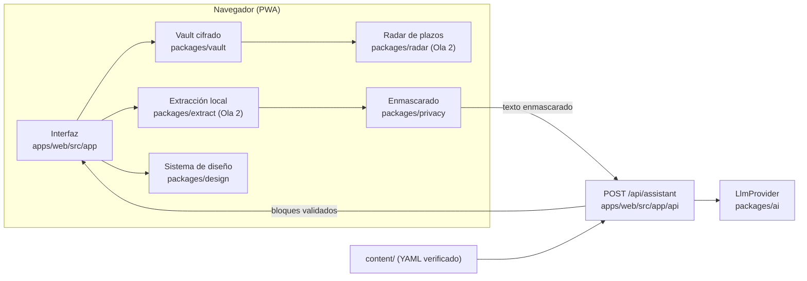

# Arquitectura de Letra Grande

Documento de referencia del código real, no del diseño inicial. El diseño y el porqué de cada decisión están en [`ARRANQUE.md`](ARRANQUE.md); aquí está cómo quedó construido y dónde vive cada cosa hoy.

Última actualización: cierre de la Ola 1.

## 1. Qué es y qué se garantiza

Una PWA abierta (MIT) que ayuda a entender facturas, contratos y cartas oficiales, y a reclamar o darse de baja. Tres garantías gobiernan toda la arquitectura:

1. **Los datos personales no salen del dispositivo.** El cifrado, la extracción y el enmascarado ocurren en el navegador. Al servidor solo llega texto ya enmascarado, y el servidor lo vuelve a comprobar.
2. **Ninguna afirmación sin fuente.** El conocimiento vive en YAML versionado, con fuente y fecha. La IA solo responde con bloques de un catálogo cerrado, cada uno con cita, y una cifra que no aparezca en la fuente citada se descarta.
3. **Nada de datos inventados.** Una ficha solo es `verified: true` si dice quién, cuándo y contra qué fuente oficial o de la empresa, y el validador lo exige en CI.

## 2. Vista general



## 3. Dónde corre cada pieza

| Pieza | Ubicación | Qué ve |
|---|---|---|
| Interfaz, rutas, shell PWA | `apps/web/src/app`, `apps/web/src/components` | Todo, incluido lo personal |
| Vault cifrado | `packages/vault` | Todo, solo en el dispositivo |
| Enmascarado y detección | `packages/privacy` | Texto antes de salir |
| Proxy del asistente | `apps/web/src/app/api/assistant` | Texto ya enmascarado, sin persistencia |
| Proveedor de IA | `packages/ai` | Texto enmascarado y la clave, solo en servidor |
| Contrato de datos | `packages/schema` | Nada de usuario: tipos y validaciones |
| Sistema de diseño | `packages/design` | Nada: componentes y tokens |
| Contenido verificado | `content/` | Datos públicos |

## 4. Paquetes y responsabilidades

### `packages/schema`: el contrato

Todo lo que se guarda, se publica o se responde pasa por aquí. Exporta los esquemas de ficha (`Company`, `Authority`, `Procedure`), el catálogo de bloques (`AssistantAnswer`, `Block`) y los registros del vault (`Profile`, `VaultDocument`, `RadarItem`).

Dos funciones son el corazón de las garantías:

- `checkVerification()`: una ficha `verified: true` exige `verifiedOn`, `verifiedBy` y al menos una fuente que no sea `tercero`.
- `validateAnswerAgainstSources(answer, sourceTexts)`: descarta una cita a una fuente desconocida y toda cifra de una afirmación que no aparezca en el texto de las fuentes citadas. Compara cifras normalizadas una a una, no subcadenas: `30` no valida contra `300` y `500` no valida contra `1.500`.

`packages/schema/scripts/validate-content.ts` (ejecutado por `pnpm content:validate`) es la puerta de CI: recorre `content/`, valida cada archivo con su esquema, exige que el nombre coincida con el id, detecta ids duplicados, comprueba que cada `escalation` apunte a un organismo existente y avisa (sin fallar) cuando una verificación supera los 180 días. La lógica vive en `src/validate-content-core.ts`, sin `process.exit`, para poder probarla.

### `packages/privacy`: la barrera del dispositivo

`detect`, `mask`, `unmask` e `isSafeToSend`. Detecta por patrón y por términos conocidos del perfil, con prioridad fija (términos conocidos, IBAN, CUPS, tarjeta, email, documento, teléfono), descarta solapes y valida lo que puede validarse: letra de DNI y NIE, módulo 97 del IBAN, Luhn de la tarjeta. Un documento o un IBAN con validación fallida **se enmascara igualmente**; una tarjeta que no pasa Luhn **no se detecta**, porque de otro modo habría demasiados falsos positivos con números de factura.

Los marcadores son estables por valor normalizado (`{{documento_1}}`), así que el mismo dato produce el mismo marcador en todo el documento, y el mapping vive solo en memoria, en la llamada.

### `packages/vault`: el almacén cifrado

IndexedDB con un almacén técnico `meta` y cinco colecciones (`profiles`, `documents`, `blobs`, `radar`, `settings`). Clave derivada de la contraseña con PBKDF2-HMAC-SHA256 y 600 000 iteraciones por defecto, sal de 16 bytes por vault y parámetros persistidos para poder migrarlos. La `CryptoKey` es no extraíble y vive solo en memoria.

Cada registro se cifra con AES-256-GCM y un IV aleatorio de 12 bytes, y **el id del registro va como `additionalData`**: intercambiar dos registros almacenados no descifra, falla. El bloqueo por inactividad usa un temporizador inyectable y descarta la clave al dispararse.

Importar una copia o purgar incrementa una **época** en `meta`. Cada sesión recuerda la época con la que abrió: si ya no coincide, cualquier operación falla con `VaultStaleSessionError`. Sin eso, una sesión abierta seguiría escribiendo con la clave vieja y esos registros serían ilegibles al reabrir.

### `packages/ai`: el proveedor como adaptador

Nadie llama a un proveedor directamente. `LlmProvider` define `complete()`; hay dos adaptadores: `nan` (compatible con OpenAI, lee `NAN_BASE_URL`, `NAN_API_KEY` y `AI_MODEL` del entorno y falla al arrancar si falta la clave) y `mock` (determinista, el de CI).

La política de errores está en el código y en [`ai-provider.md`](ai-provider.md): 401, 402, 403 y 404 no se reintentan; 429 y 5xx sí, con espera exponencial y variación aleatoria, dos intentos en total; un aborto o un timeout no se reintentan. El circuit breaker solo cuenta fallos reintentables, para que una clave mala no lo abra. La cuota por usuario anónimo es un cubo de fichas con tope de usuarios y expulsión del menos reciente, y el presupuesto diario corta por sí solo.

El paquete tiene una guarda de servidor: cargarlo en un contexto de navegador lanza un error. La clave nunca se registra, ni aparece en una respuesta ni en un mensaje de error.

### `packages/design`: sistema de diseño

Tokens con contraste medido en test, `Callout` con cuatro tonos y etiqueta textual (nunca solo color), un componente por `kind` del catálogo con su cita visible y enlazada, y una galería estática generada sin bundler que se comprueba con axe.

Tiene dos entradas: `@letra-grande/design/client` con lo que el navegador puede usar, y el barril completo `@letra-grande/design`, que además expone la galería y no debe importarse desde el cliente porque arrastra `react-dom/server` y `node:fs`.

### `apps/web`: la app

Next.js 16 con App Router y TypeScript 7. Ocho rutas de módulo (`hoy`, `asistente`, `carpeta`, `reclamar`, `vida`, `ayudas`, `datos`, `familia`) y la portada, con los estilos en CSS propio y los tokens del sistema de diseño. El shell, la navegación inferior, el renderizador de bloques y el registro del service worker viven en `src/components/shell/` y `src/components/blocks/`.

El service worker cachea solo el shell (raíz, manifiesto e iconos), sirve las navegaciones con estrategia network-first y **nunca** cachea respuestas del asistente ni blobs de documentos. El manifiesto declara `id` para que la identidad de la PWA sea estable.

### `packages/radar`: plazos y calendario

Lógica pura: `addDeadline` suma un plazo por unidad (días naturales, días hábiles, meses o años) y declara cuándo el resultado es aproximado, `deadlineStatus` y `sortRadarItems` ordenan la línea de tiempo y `toIcs` exporta los pendientes a un calendario de todo el día. Sin red, sin reloj implícito y sin dependencias. El detalle está en [`data-model.md`](data-model.md), sección 10.

### Escritorio

La misma interfaz se empaqueta como aplicación de escritorio con Electron, que reusa el build estático de `apps/web`. El binario **no lleva la clave de IA**: el asistente sigue llamando al proxy alojado. La decisión, la seguridad del envoltorio y lo que falta están en [`desktop.md`](desktop.md).

### Paquete de la Ola 2 pendiente

`packages/extract` (PDF, OCR y extractores) todavía no existe: se crea en su tarea, que es cuando tiene código y tests que lo justifiquen.

## 5. Flujo de una pregunta al asistente

1. **En el navegador** se enmascara el texto con `mask()`. Contar y mostrar a la persona cuántos datos se ocultaron es de la interfaz del asistente, todavía pendiente: hoy la función existe y el contador no.
2. **`POST /api/assistant`** valida la forma y el tamaño del cuerpo (20 KiB y 4000 caracteres), con lector acotado también cuando no hay `Content-Length`.
3. **Segunda barrera**: el servidor vuelve a ejecutar `detect()`; si encuentra algo, responde 422 pidiendo enmascarar en el navegador y **no repite el valor detectado**.
4. **Cuota**: se comprueba la del usuario anónimo (hash truncado de IP, `User-Agent` y `Accept-Language`); un fallo del proveedor no consume ficha.
5. **Proveedor**: se llama con tiempo de espera de 30 s. Los errores se degradan a 503 sin detalles internos.
6. **Validación**: la respuesta del modelo se parsea con `AssistantAnswer` y se valida contra las fuentes recuperadas. Si no encaja, un único reintento lleva **solo los errores**, nunca la respuesta del modelo. Si vuelve a fallar, la salida es `outOfScope`.
7. **Render**: `AssistantAnswerView` mapea cada bloque a su componente y pasa el catálogo de fuentes para que la cita sea un enlace con título. Nada del modelo se interpreta como marcado.

Hasta que exista AI-03, el recuperador devuelve vacío y el endpoint responde `outOfScope` de forma determinista: degradación honesta, no invención.

## 6. Flujo de un documento (Ola 2)

1. El archivo se lee en local (`pdf.js` para texto, OCR en el navegador para fotos).
2. `packages/extract` extrae campos y los declara como leídos o no leídos.
3. `packages/schema` valida el registro, `packages/vault` lo cifra y lo guarda.
4. Un plazo extraído crea un `RadarItem` con la fecha que calcula `addDeadline` de `packages/radar`; el radar lo ordena y `toIcs` lo exporta a un calendario de todo el día.

Nada de este flujo hace una petición de red, y hay un test de e2e que falla si aparece alguna.

## 7. Seguridad

- **Superficie pública**: el endpoint del asistente. Todo lo demás es estático o local. Tiene límites de tamaño, segunda barrera de privacidad, cuota, tiempo de espera, circuit breaker y errores sin eco.
- **Clave de IA**: solo en variables de entorno del servidor, nunca `NEXT_PUBLIC_*`, nunca en el bundle (hay guarda de servidor y test).
- **Sin terceros en el navegador**: ni analytics, ni fuentes remotas, ni scripts externos. El guardián de red de Playwright falla si algo sale a un origen ajeno o si un cuerpo lleva datos personales.
- **Service worker**: precachea solo el shell; las navegaciones van a red con respaldo de caché para no servir HTML viejo tras un despliegue.
- **Límites conocidos**: el cifrado en IndexedDB no protege frente a malware en el dispositivo ni frente a XSS, y nombres y direcciones solo se ocultan si están en el perfil del usuario. Ambos límites deben decirse en la interfaz.

## 8. Decisiones de ingeniería tomadas durante la Ola 1

| Decisión | Motivo |
|---|---|
| Next en modo webpack (`next dev --webpack`, `next build --webpack`) | Los paquetes del workspace son fuentes TypeScript con especificadores ESM `.js`; se resuelven con `webpack.resolve.extensionAlias`, que Turbopack todavía no ofrece. Deuda: `REF-OPS-06`. |
| e2e en la imagen oficial de Playwright | `playwright install --with-deps` se colgaba de forma intermitente en runners Ubuntu. La imagen trae navegadores y dependencias; con `--ipc=host --user 1001` Firefox arranca. |
| Review gate exigible en CI | `scripts/check-review-report.mjs` falla si un PR con id de tarea no trae `odd/reviews/<id>.md`, y falla también con veredicto `rechazado`. |
| Época de sesión en el vault | Sin ella, importar o purgar dejaba sesiones vivas escribiendo con la clave vieja. |
| `packages/radar` y `packages/extract` en la Ola 2 | Un paquete vacío obliga a `--passWithNoTests` permanente o a un test falso. |
| Dependencias declaradas por adelantado | Para que las tareas en paralelo no compitieran por el lockfile. |

## 9. Cómo se verifica

```
pnpm check   # estilo, tipos, tests de todos los paquetes y validación de contenido
pnpm build   # build de producción de la PWA
pnpm e2e     # flujo real en chromium, firefox, webkit y mobile-chrome
```

La CI ejecuta los tres en cada PR, más la comprobación del informe de review. `pnpm style` prohíbe rayas largas y medias rayas en documentación y código.

## 10. Deuda y límites abiertos

Los refactores pendientes están en la tabla de `docs/backlog.md` con prefijo `REF-`. Los riesgos que no son deuda técnica sino decisiones humanas (H-07, verificación de contenido; H-08, condiciones de NaN) están en [`ARRANQUE.md`](ARRANQUE.md), sección 17.
